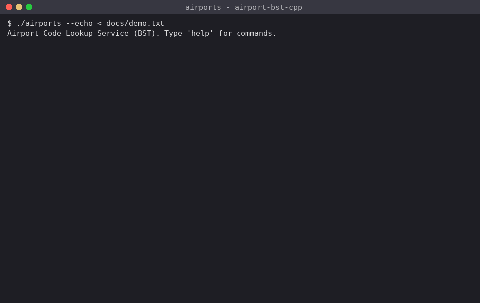

# airport-bst-cpp

An airport code lookup service built on a hand-written binary search tree in C++17, keyed by
three-letter IATA code and loaded with 6,072 real airports from the OpenFlights database.
EECE 2560 Mini Project, Fall 2026.

Author: Dhanush Karthik Ravichandran, Northeastern University



## The problem

Bookings, boarding passes and bag tags identify airports by IATA code (BOS, JFK, DAC). A travel
company needs a service that turns a code into the airport's name, city, country and location,
stays correct while airports are added and removed, and answers alphabetical listings and range
queries such as "every code from BOS to BWI". Every operation runs in O(h), where h is the tree
height, so the project also measures how insertion order changes h.

## Build and run

```
g++ -std=c++17 -O2 src/*.cpp -o airports
./airports                          # interactive
./airports --echo < docs/demo.txt   # scripted demo (echoes each command)
```

| Command | What it does |
|---|---|
| `load FILE` | Load `airports.dat` (builds the tree in file order) or a file written by `save` |
| `find CODE` | Search; prints the path of every code compared and the number of comparisons |
| `min`, `max` | Smallest and largest code |
| `remove CODE` | Delete, reporting the case (D1 leaf, D2 one child, D3 two children) and re-validating |
| `add CODE \| Name \| City \| Country [\| ICAO \| lat \| lon]` | Insert a new airport |
| `list [N]` | Inorder (alphabetical) listing with a sortedness check |
| `save FILE` / `load FILE` | Write the tree in preorder / rebuild it with the same shape |
| `roundtrip FILE` | Save, reload into a second tree, compare height and full level order |
| `validate` | BST check with the (lo, hi) range method |
| `range FROM TO [-q]` | Every airport with FROM ≤ code ≤ TO, plus the number of nodes visited |
| `levels [K]` | Level order of the top K levels |
| `build file\|sorted\|shuffle [check]` | Rebuild from the loaded records (`check` validates after every insert) |
| `rebalance` | Balanced rebuild, middle element as root |
| `test` | Runs every Task 2 search case and Task 3 delete case, then restores the tree |
| `experiment` | Prints the Task 6 table |

## Project layout

```
src/Airport.h, Airport.cpp        record class and the CSV parser (quoted commas, "" escapes, \N)
src/AirportBST.h, AirportBST.cpp  the tree (root is private); insert/search/delete are iterative
src/main.cpp                      command loop, tests and the shape experiment
data/airports.dat                 course copy of the OpenFlights file (download.sh fetches the upstream one)
docs/pseudocode.md                pseudocode for build, insert, search, delete, validate, range, balanced build
docs/demo.txt                     script used for the recorded session
docs/demo.gif                     recording of the demo session
docs/sample_session.txt           output of the demo script
docs/test_output.txt              output of `test` and `roundtrip`
```

## Sample session

```
> load data/airports.dat
Loaded 6072 airports (1626 lines skipped: no IATA code). Duplicates: 0
Lines read: 7698  Records stored: 6072  from data/airports.dat
Height: 177  Average depth: 18.3
> find BOS
Path: GKA -> AEY -> EGS -> BUJ -> BJA -> BSK -> BOY -> BNI -> BOH -> BOO -> BOU -> BOS (comparisons: 12)
BOS  General Edward Lawrence Logan International Airport, Boston, United States
    ICAO: KBOS   lat 42.36430, lon -71.00520
> find XYZ
Path: GKA -> MAG -> POM -> WWK -> YAM -> XFW -> XGN -> XLS -> XRY -> XVS -> YAI -> YAA -> XYA -> XYE -> (NULL) not found (comparisons: 14)
> range BOS BWI -q
113 airports, 127 nodes visited
> remove AEY
Deleted AEY (case D3: two children, replaced by inorder successor AFA)  validate: OK
> remove BOS
Deleted BOS (case D2: only a left child, BOR)  validate: OK
> rebalance
Height: 12  Average depth: 10.7  Nodes: 6070
```

## Verification against the posted file

| Check | Expected | Result |
|---|---|---|
| Lines / airports with IATA / skipped | 7,698 / 6,072 / 1,626 | 7,698 / 6,072 / 1,626 |
| Duplicates | 0 | 0 |
| Countries / US airports | 235 / 1,251 | 235 / 1,251 (`stats`) |
| File-order height, average depth | 177, 18.3 | 177, 18.3 |
| `find BOS` comparisons | 12 | 12 |
| `range BOS BWI` | 113 airports, 127 visited | 113 airports, 127 visited |
| `remove BOS` | D2, left child BOR | D2, left child BOR |
| Balanced height, average depth | 12, 10.7 | 12, 10.7 |
| Inorder sorted, preorder reload same shape | yes | yes (height and every level identical) |
| validate after every insert (6,072) and every delete | OK | OK |

Delete cases tested by `test` on the file-order tree: leaf AAC (D1), GJT with only a left child (D2),
GJM with only a right child (D2), AEY with two children (D3, successor AFA), and the root GKA (D3,
successor GKE becomes the root). The made-up airport QQQ is added, found in 22 comparisons, and removed.

## Task 6: the shape experiment

Same 6,072 codes, same 10,000 random successful searches for every tree (fastest of 5 runs,
`-O2`; times depend on the machine, the ratios are what matter).

| Build order | Height | Average depth | Time for 10,000 searches | Explanation |
|---|---|---|---|---|
| File order | 177 | 18.32 | 2.2 ms | Long sorted runs in the file form chains (below) |
| Sorted order | 6,071 | 3,035.50 | 192 ms | Every key is larger than all before it, so each goes to the right: a linked list, n − 1 |
| Balanced (middle rule) | 12 | 10.65 | 1.8 ms | Middle element at every root; height ⌊log₂ 6072⌋ = 12, the minimum possible |
| Random shuffle (bonus, 10 seeds) | 26–29 | 14.17 | 2.3 ms | No sorted runs survive; expected average depth 2(1 + 1/n)Hₙ − 4 ≈ 14.6, close to the measured 14.2 |

**Why file order is so much worse than a shuffle.** The file is ordered by OpenFlights airport ID,
and the IDs were assigned country by country (Papua New Guinea, Greenland, Iceland, Canada, …), with
airports inside a country roughly in ICAO order. ICAO and IATA codes often line up, so long stretches
of the file are already in increasing IATA order: 58% of adjacent airport pairs are ascending, and the
Canadian block (IDs 42–206) is a single run of 162 codes in increasing order, from YDA to ZFM. Those
codes arrive early, all land in the right subtree of YAM, and each one becomes the right child of
the previous one, forming a chain. That is why the deepest node, YZR (Sarnia), is reached after
178 comparisons through YAY → YAZ → YBB → … → YZP. A random shuffle breaks these runs, so the height
drops to 26–29.

**Why the timing gap is smaller than the height gap.** Search cost is O(depth of the key searched),
not O(h). Random searches pay the average depth: 18.3 for file order versus 10.7 balanced, so roughly
1.7× more comparisons, while only the airports in the chained region (mostly Canada) pay the full
height. The sorted chain is different in kind: average depth 3,035, so 10,000 searches cost about
30 million comparisons and run about 100× slower than the balanced tree.

## Implementation notes

- Insert, search, delete, height, validate and every traversal are iterative (`while` loops with an
  explicit stack or queue). Building 6,072 sorted keys recursively would need a 6,071-frame call stack.
- Deleting a node with two children copies its inorder successor (minimum of the right subtree) into
  it and unlinks the successor, which has no left child.
- `save` writes one record per line in preorder. Re-inserting in that order rebuilds the same tree,
  because each node is inserted after all of its ancestors and follows the same comparisons.
- The range query only goes left when `FROM < key` and only goes right when `key < TO`, so subtrees
  outside the range are never entered; it counts every node pushed.

## Data credit

Airport data from **OpenFlights.org** (https://openflights.org/data.php, repository
jpatokal/openflights), available under the Open Database License.
